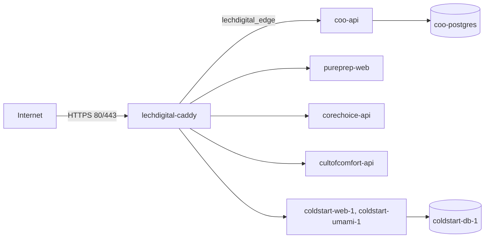

# lechdigital-infra

The shared hosting of Lech Digital's projects: one Hetzner server (`lechdigital-prod`), one Caddy in front of every
project, and one deploy workflow that each project calls. The projects stay in their own repositories, with their own
Dockerfile and compose file; this repository holds only what they share.

| What | Where |
|---|---|
| The server | Hetzner Cloud `lechdigital-prod` (CX22-class, 4 GB, nbg1), 167.233.145.128; SSH alias `lechdigital-prod` |
| The edge | `edge/`: `compose.yml`, `Caddyfile`, one `sites/<project>.caddy` per project; on the server `/opt/lechdigital-edge` |
| A project | `/opt/<project>`: its `deploy/docker-compose.prod.yml` and `.env` (secrets, created on the server, never in git) |
| Host chores | `host/`: the weekly Docker build-cache clean-up, the `deploy` user |

## Deploying

Nothing reaches production on a push. Each project's **Deploy (production)** workflow builds and tests on every run,
and runs only when someone presses **Run workflow** (Actions tab, or the GitHub mobile app): the one-click approval for
every project. It calls `deploy-app.yml` here, which builds the image on GitHub, streams it to the server over SSH, starts
it with the project's compose file and waits until the project's health URL reports the commit. The server keeps the
last three images of each project.

**Rollback:** run the project's deploy workflow on the previous commit (Run workflow → choose the branch or tag), or on
the server: `cd /opt/<project> && IMAGE_TAG=<old sha> docker compose --env-file .env -f deploy/docker-compose.prod.yml up -d --no-build`.

The edge has its own workflow (`Edge`): every push validates the Caddyfile; Run workflow copies it to the server and
reloads Caddy in place.

## Secrets

- On the server, per project: `/opt/<project>/.env`, mode 600, owned by `deploy`. Generated there (`openssl rand`),
  never printed, never in git or GitHub.
- In each project's GitHub repository: `DEPLOY_SSH_KEY` (the `deploy` user's private key) and `DEPLOY_KNOWN_HOSTS`
  (the server's host keys). GitHub Free does not share organisation secrets with private repositories, so each
  repository has its own copy.

See `docs/add-a-project.md` for a new project, and `docs/migration.md` for the move from the Coldstart-owned setup.
